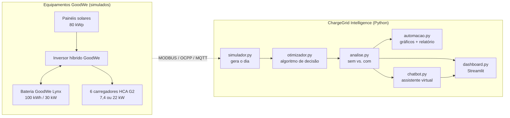
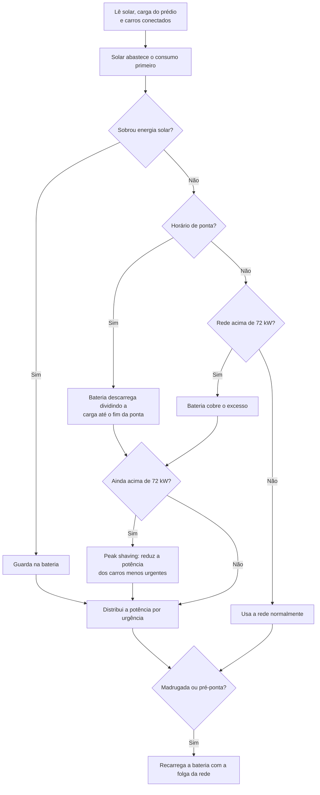
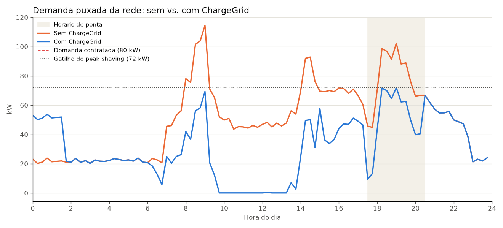
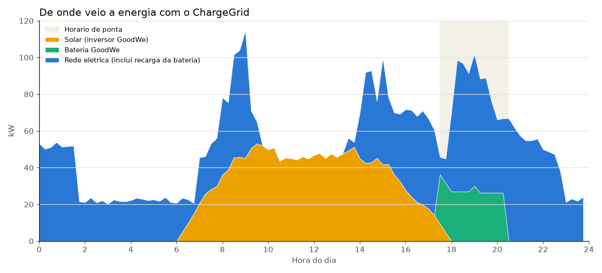
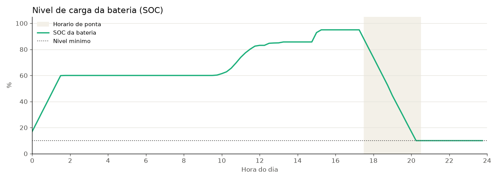
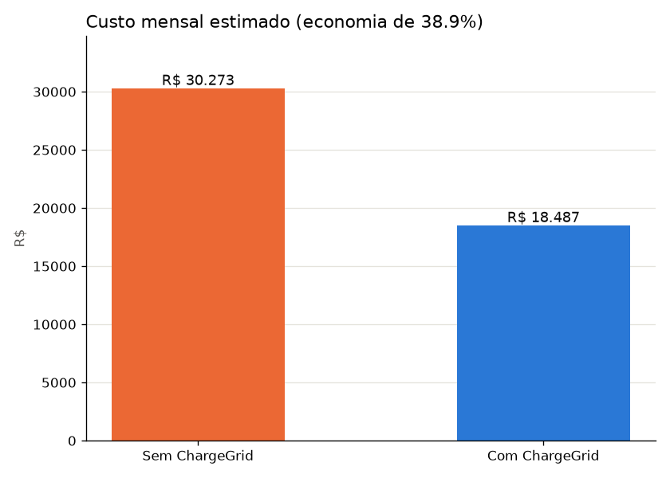

    # ⚡ ChargeGrid Intelligence — Sprint 4

**Solução final integrada | EV Challenge GoodWe 2026**
Pensamento Computacional e Automação em Python · Grupo 5 · Turma 1CCPY · FIAP

> Plataforma em Python que gerencia a energia de um estacionamento com carregadores de veículos elétricos, combinando geração solar, bateria e controle inteligente de demanda com equipamentos GoodWe.

🎥 **Vídeo da solução:** _(adicionar link do YouTube)_

---

## 👥 Equipe

| Nome | RM |
|---|---|
| Jair Ferreira dos Santos Neto | 569682 |
| Matheus da Costa Gonçalves | 570756 |
| Yan Luiz Neves Lemos | 571717 |
| Arthur dos Santos Bezerra | 569721 |
| Carlos Henrique Fratezi | 571792 |

---

## 🎯 O problema

A GoodWe quer levar a recarga de veículos elétricos do ambiente residencial para o comercial. Num estacionamento como o L1 da FIAP isso esbarra em três problemas:

- **Picos de demanda:** quando vários carros chegam juntos, a potência puxada da rede passa da demanda contratada e a distribuidora cobra multa de ultrapassagem.
- **Horário de ponta caro:** os alunos do noturno chegam justamente entre 17h30 e 20h30, quando a energia custa mais.
- **Energia renovável mal aproveitada:** sem gestão, a geração solar não é combinada com a bateria e com o horário de recarga dos carros.

---

## 💡 A solução

O ChargeGrid Intelligence simula um dia completo do estacionamento e decide, a cada 15 minutos, **de onde tirar a energia e quanto entregar para cada carro**. Depois compara o resultado com o mesmo dia sem o sistema.

### O que mudou da Sprint 2 para a Sprint 4

| Sprint 2 | Sprint 4 |
|---|---|
| Simulação de 600 segundos (a hora nunca saía da meia-noite) | Dia completo de 24 h em intervalos de 15 min |
| Bateria sem limite de carga | Bateria com SOC, eficiência, potência máxima e nível mínimo |
| Peak shaving liga/desliga sem critério | Peak shaving que prioriza os carros com maior urgência |
| Parâmetros diferentes no Python e no HTML | Todos os parâmetros num único `config.py` |
| Multa “R$ 0,00” escrita fixa no código | Multa calculada a partir da demanda real |
| Sem comparação de resultados | Comparativo sem vs. com ChargeGrid |
| Sem relatórios | Gráficos e relatório gerados automaticamente |
| Sem assistente | Assistente virtual (Groq + Llama 3.3) integrado ao dashboard |

---

## 🏗️ Arquitetura final



### Módulos

| Arquivo | Função |
|---|---|
| `config.py` | Todos os parâmetros do sistema (demanda, tarifas, bateria, solar, CO₂) |
| `simulador.py` | Gera 24 h de dados: curva solar com nuvens, carga do prédio, chegada dos carros e recarga sem controle |
| `otimizador.py` | Algoritmo do ChargeGrid: decide a cada 15 min o uso do solar, da bateria e da rede e a potência de cada carregador |
| `analise.py` | Calcula custo, multa, pico, energia renovável e CO₂ dos dois cenários |
| `automacao.py` | Gera os gráficos em PNG e o relatório diário em Markdown, com os eventos do dia |
| `chatbot.py` | Assistente que responde perguntas sobre os resultados (Groq/Llama 3.3 ou modo offline) |
| `dashboard.py` | Painel em Streamlit com indicadores, gráficos, sessões de recarga e o assistente |
| `main.py` | Roda todo o fluxo de uma vez |

### Como o algoritmo decide (a cada 15 minutos)



A **urgência** de cada carro é a energia que ainda falta dividida pelo tempo que ele ainda vai ficar na vaga. Assim, quando é preciso cortar potência, quem vai sair logo continua carregando e quem tem tempo sobrando espera um pouco.

---

## 🔌 Por que cada tecnologia GoodWe

| Tecnologia | Papel na solução | Por que ela |
|---|---|---|
| **Carregador GoodWe HCA G2** | Ponto de recarga das 6 vagas | Permite ajustar a potência de recarga, o que viabiliza o peak shaving sem desligar o carro |
| **Inversor híbrido GoodWe** | Junta solar, bateria e rede num único equipamento | Faz a carga e descarga da bateria sem precisar de inversores separados |
| **Bateria GoodWe Lynx** | Armazena o excedente solar e cobre a ponta | Modular: dá para começar menor e ampliar conforme o número de vagas cresce |
| **SEMS Portal / API** | Fonte dos dados de geração e consumo | É de onde, em produção, o sistema leria os dados reais no lugar do simulador |
| **OCPP / MODBUS / MQTT** | Comunicação com carregadores e inversor | Protocolos abertos, então o sistema também funciona com carregadores de outros fabricantes |

---

## 📊 Resultados obtidos

Os números abaixo saem direto da execução do `main.py`. A semente aleatória é fixa, então qualquer pessoa que rodar o projeto chega aos mesmos valores.

**Cenário:** dia útil, 16 veículos, 6 vagas, demanda contratada de 80 kW.

| Indicador | Sem ChargeGrid | Com ChargeGrid |
|---|---|---|
| Pico de demanda | 114,5 kW | **72,0 kW** |
| Intervalos acima do contratado | 11 de 96 | **0** |
| Energia comprada da rede (dia) | 1.204,0 kWh | **755,9 kWh** |
| Energia da rede no horário de ponta | 233,9 kWh | **149,6 kWh** |
| Energia entregue aos veículos | 316,2 kWh | **316,2 kWh** |
| Multa de ultrapassagem (mês) | R$ 2.757,60 | **R$ 0,00** |
| Custo total estimado (mês) | R$ 30.272,93 | **R$ 18.486,80** |
| Emissão de CO₂ (dia) | 34,8 kg | **21,8 kg** |

**Resumo:**

- 💰 Economia de **R$ 11.786,13 por mês (38,9%)**, cerca de R$ 141 mil por ano.
- 📉 Pico de demanda **37,1% menor**, com a multa de ultrapassagem zerada.
- ☀️ **100%** da energia solar gerada foi aproveitada, e o sol atendeu **37,5%** do consumo do dia.
- 🚗 Os carros receberam **a mesma energia** que receberiam sem controle: o peak shaving só redistribuiu a recarga no tempo.
- 🌱 Cerca de **3,4 toneladas de CO₂ evitadas por ano**.

### Gráficos









### Resultados qualitativos

- O operador do estacionamento vê tudo num painel em português, sem precisar entender de MODBUS ou OCPP.
- O assistente virtual responde perguntas como “quanto economizamos?” ou “por que a bateria esvaziou?”.
- O relatório diário com os eventos do dia (início da ponta, peak shaving, bateria no mínimo) é gerado sem ninguém precisar montar planilha.

---

## 🧠 Conexão com a disciplina

| Conceito de Pensamento Computacional | Onde aparece no projeto |
|---|---|
| **Decomposição** | O problema foi dividido em módulos: simular, otimizar, analisar, automatizar, visualizar e conversar |
| **Reconhecimento de padrões** | Picos de demanda sempre na chegada dos carros (manhã, almoço e noturno) e solar sobrando no meio do dia |
| **Abstração** | O estacionamento virou uma tabela de 96 intervalos. Cada carro virou um dicionário com chegada, saída e energia pedida |
| **Algoritmo** | Regras de decisão em ordem de prioridade (solar → bateria → rede) e fila de prioridade por urgência no peak shaving |

**Automação em Python:** um único comando (`python main.py`) gera os dados, roda a otimização, calcula os indicadores, cria os 4 gráficos e escreve o relatório. Bibliotecas usadas: `pandas` (dados), `matplotlib` (gráficos), `streamlit` (dashboard) e `groq` (assistente).

---

## ⚖️ Avaliação crítica

**O que funcionou bem**

- O peak shaving segurou a demanda em 72 kW o dia todo sem deixar nenhum carro com menos energia do que no cenário sem controle.
- A estratégia de dividir a bateria ao longo da ponta evitou que ela esvaziasse logo no começo, que foi o que aconteceu na primeira versão do algoritmo.
- A comparação é justa: a bateria começa e termina o dia no mesmo nível (10%), então a economia não vem de “gastar” a bateria.

**Limitações**

- **Os dados são simulados.** Os parâmetros são compatíveis com equipamentos GoodWe, mas o próximo passo seria ler os dados reais pelo SEMS Portal.
- **O ganho de CO₂ é pequeno** porque a matriz elétrica brasileira já é muito limpa (0,0289 kg de CO₂ por kWh, segundo o MCTI). O maior ganho ambiental está em consumir energia solar local e aliviar a rede no horário de pico.
- **As tarifas são simplificadas** (R$ 1,20 na ponta e R$ 0,85 fora). Uma tarifa real da Enel tem mais componentes.
- **A maior parte da economia vem do solar.** O controle inteligente é o que garante que esse solar seja todo aproveitado e que a multa não aconteça.
- **O custo do investimento** (painéis, bateria e carregadores) não foi incluído, então o payback ainda precisa de um orçamento real.

---

## ▶️ Como rodar

Pré-requisito: Python 3.10 ou mais novo.

```bash
python -m venv venv
venv\Scripts\activate
pip install -r requirements.txt
python main.py
streamlit run dashboard.py
```

No Linux/Mac, o segundo comando é `source venv/bin/activate`.

Para usar o assistente com IA, crie uma chave gratuita em console.groq.com e defina a variável no mesmo terminal, antes de abrir o dashboard (PowerShell):

```bash
$env:GROQ_API_KEY="sua_chave_aqui"
```

Sem a chave, o assistente funciona em modo offline, respondendo com base nos resultados calculados.

### Estrutura do repositório

```
ChargeGrid_Grupo5/
├── config.py
├── simulador.py
├── otimizador.py
├── analise.py
├── automacao.py
├── chatbot.py
├── dashboard.py
├── main.py
├── requirements.txt
├── .gitignore
├── README.md
├── dados/          (CSVs gerados)
├── graficos/       (PNGs gerados)
└── relatorios/     (relatório diário gerado)
```

---

## 📚 Referências

- GoodWe: carregador HCA G2, inversores híbridos e baterias Lynx — https://www.goodwe.com
- GoodWe SEMS Portal — https://www.semsportal.com
- Open Charge Alliance, protocolo OCPP — https://www.openchargealliance.org
- ANEEL, Resolução Normativa nº 1.000/2021 (regras de ultrapassagem de demanda)
- Enel SP, glossário da conta de energia (horário de ponta 17h30–20h30) — https://www.enel.com.br/content/dam/enel-br/megamenu/informativos/glossario-conta-energia/glossario-energia-SP.pdf
- MCTI, fatores de emissão de CO₂ do SIN (via Canal Solar) — https://canalsolar.com.br/emissoes-de-co%e2%82%82-geracao-eletrica-mcti/
- pandas — https://pandas.pydata.org
- Matplotlib — https://matplotlib.org
- Streamlit — https://streamlit.io
- Groq API — https://console.groq.com/docs

---

*FIAP 2026 · EV Challenge GoodWe · Grupo 5 · Turma 1CCPY*